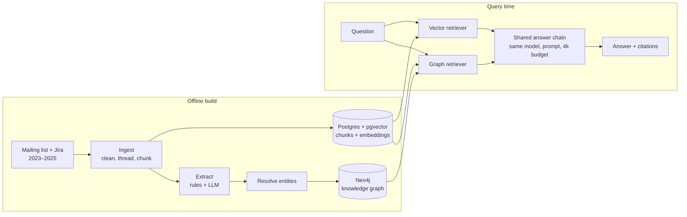
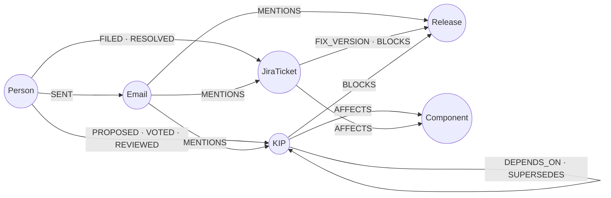
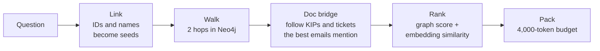
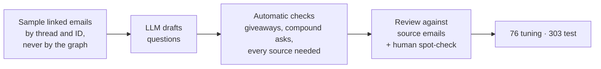
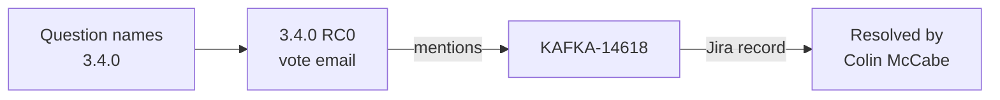

# Kafka Atlas

[](https://github.com/arjunchhabra1/kafka-atlas/actions/workflows/ci.yml) [](LICENSE)

An engineering knowledge assistant over the Apache Kafka developer mailing list. It answers questions such as *"Which release fixed the ticket Colin McCabe cited when voting −1 on 3.6.2 RC1?"* with cited sources, and it is built to answer one question with a controlled experiment: **does a knowledge graph retrieve better than plain vector search when the answer spans several documents?**

The corpus is three years (2023–2025) of `dev@kafka.apache.org` plus its Jira activity: a public stand-in for the Slack, email and ticket history that companies index internally. Two systems answer the same questions with the same model, prompt and context budget, so retrieval is the only thing that differs:

- **Vector RAG baseline:** LangChain + pgvector nearest-neighbour search over email and Jira chunks
- **Graph RAG:** an LLM-extracted knowledge graph in Neo4j, queried through entity linking and multi-hop traversal

**Stack:** Python 3.12 · Claude Sonnet 5.5 · Voyage embeddings · Postgres + pgvector · Neo4j · LangChain · FastAPI · Docker · GitHub Actions

## Highlights

- **Result:** on 176 held-out multi-hop questions, graph retrieval delivered every needed document **11 points more often** than vector search (45% vs 34%, 95% CI +4 to +19), with no loss on single-hop questions
- **Knowledge graph:** 11,847 emails and 9,380 Jira events become a graph of 24,376 nodes and 54,127 relationships, every edge traceable to its source text
- **Entity resolution:** a deterministic resolver scores **B³ F1 0.965** with zero wrong merges, against **0.750** for exact-match merging
- **Evaluation:** 379 questions reviewed against their source emails, with a 303-question held-out test set run once

## Architecture



## How it works

- **Ingestion:** quoted replies, signatures, stack traces and patches are stripped; emails are threaded and chunked to 500 tokens; Jira notifications become structured events
- **Extraction:** IDs and Jira events are parsed by rule; an LLM extracts only people, components and relations such as *proposed*, *voted* and *blocks*, through the Batches API with caching and a cost guard
- **Entity resolution:** mentions like "Andrew Schofield", "Andrew" and an email address are merged into one person by rules, never guessed; ambiguous names stay unresolved
- **Graph:** every edge stores the IDs of the chunks that justify it, so the graph retrieves source text, not summaries



### Graph retrieval



Multi-hop questions often describe a KIP only through another discussion ("the ticket Colin cited in the vote"), which puts the answer three hops from anything named in the question. The doc-bridge step handles this: it pivots on the best-matching emails and walks from the KIPs and tickets those emails mention. It came from tracing misses during development, where 42% of the needed documents sat beyond a two-hop walk.

## Entity resolution

Scored on 188 hand-labelled mentions of 22 people and components:

| Resolver | B³ precision | B³ recall | B³ F1 |
| --- | --- | --- | --- |
| Exact match (baseline) | 0.991 | 0.603 | 0.750 |
| **Kafka Atlas resolver** | **1.000** | **0.933** | **0.965** |

## Evaluation



| Type | What it tests | Questions |
| --- | --- | --- |
| Single-hop | One fact from one document | 121 |
| Inference | One email identifies a KIP or ticket, another states the answer | 166 |
| Comparison | Two related KIPs or tickets compared on substance | 48 |
| Temporal | How a proposal changed after review | 6 |
| Null | Unanswerable from the list; the system should decline | 38 |

Questions were drafted by an LLM, **LLM-reviewed against their source emails**, and **a random sample was human-verified** (50 of 50 decisions confirmed). The retriever was tuned only on the tuning split, and each system ran on the test split once.

## Results

Held-out test split, 303 questions, both systems paired on the same questions with 95% bootstrap confidence intervals:

| Multi-hop (176 questions) | Vector | Graph | Graph − vector |
| --- | --- | --- | --- |
| **Full-evidence rate** (every needed document retrieved) | 0.34 | 0.45 | **+0.11 [+0.04, +0.19]** |
| Source recall | 0.56 | 0.61 | +0.05 [−0.01, +0.11] |

| Full-evidence rate by type | Vector | Graph |
| --- | --- | --- |
| Single-hop (97) | 0.90 | 0.90 |
| Inference (133) | 0.27 | 0.37 |
| Comparison (38) | 0.50 | 0.66 |
| Temporal (5) | 0.80 | 1.00 |

## Example

A held-out multi-hop question. Answering it needs the release-vote email that names the blocker and the Jira record of who resolved it; the question names neither.

> **Who resolved the ticket that was flagged as a blocker during the 3.4.0 RC0 vote, requiring a new release candidate?**



- **Vector RAG** found the vote email but not the Jira record: *"The sources don't say who resolved it."*
- **Graph RAG** followed the ticket the vote email mentions to its Jira record: *"Colin McCabe resolved it… Jira shows Colin McCabe resolved KAFKA-14618 as Fixed in 3.4.0 on 2023-01-13."*

## Quickstart

Requires Docker, [uv](https://docs.astral.sh/uv/), an Anthropic API key and a Voyage API key. Commands that call paid APIs print a cost estimate and ask first.

```bash
uv sync
cp .env.example .env                      # add ANTHROPIC_API_KEY and VOYAGE_API_KEY
docker compose up -d                      # Postgres (pgvector) and Neo4j

uv run kgrag ingest --from 2023-01 --to 2025-12
uv run kgrag extract
uv run kgrag resolve --resolver user
uv run kgrag build --resolver user
uv run kgrag index

uv run kgrag eval --system vector --split dev
uv run kgrag eval --system graph --resolver user --split dev
uv run kgrag report results/*.json --split dev

uv run kgrag serve                        # FastAPI: POST /ask {"question", "system"}
```

## Limitations

- One corpus and one time window; results may not generalise to other projects or periods
- Questions are drafted from header- and ID-linked evidence, so they over-represent relations visible through explicit IDs and threads
- Temporal questions are scarce (6): Kafka design revisions mostly live on the wiki, and the list only links to them
- Ambiguous first names ("Chris", "David") are left unresolved rather than guessed

## Testing

```bash
uv run pytest                       # everything not marked live
uv run pytest -m "not integration"  # unit tests only, no Docker
```

744 tests, including Postgres and Neo4j integration tests via testcontainers and an offline end-to-end smoke test. GitHub Actions runs the suite on every push.

## Project layout

```
src/kgrag/
  ingest/     parse, clean, thread, chunk; Jira parser
  extract/    rule and LLM extraction
  resolve/    entity resolution
  graph/      Neo4j build and access
  retrieve/   vector and graph retrievers
  answer/     shared answer chain
  questions/  evaluation question pipeline
  eval/       runner, metrics, confidence intervals, report
  api/        FastAPI service
tests/        unit, integration and end-to-end tests
```
