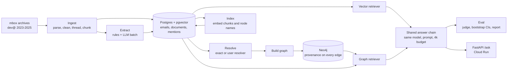

# Kafka Atlas

An engineering knowledge assistant over the Apache Kafka developer mailing list. It answers questions such as "who took part in both the KIP-1032 and KIP-1043 discussions, and what did they say?" with cited sources, and it is built to test one question: **does a knowledge graph retrieve better than plain vector search when an answer spans several documents?**

The corpus is three years (2023-2025) of `dev@kafka.apache.org` plus its Jira activity. It is a public stand-in for the Slack, email and ticket history that companies index internally. Two systems answer the same questions with the same model, prompt and context budget, so retrieval is the only thing that differs:

- **Vector RAG baseline:** LangChain + pgvector, nearest-neighbour search over email and Jira chunks.
- **Graph RAG:** an LLM-extracted knowledge graph in Neo4j, queried through entity linking and bounded multi-hop traversal, with every edge pointing back to the chunks that justify it.

**Stack:** Python 3.12, Claude Sonnet 5.5 (extraction, question drafting, answering) and Claude Opus 5.5 (judge), Voyage embeddings, Postgres + pgvector, Neo4j, LangChain, FastAPI, Docker, GCP (Cloud Run, Cloud SQL), Langfuse, GitHub Actions.

## Architecture



## Quickstart

Requires Docker, [uv](https://docs.astral.sh/uv/), and an Anthropic API key (plus a Voyage key for embeddings).

```bash
uv sync
cp .env.example .env                       # add ANTHROPIC_API_KEY and VOYAGE_API_KEY (loaded automatically by kgrag)
# set models.embed in config.yaml to a Voyage model (it ships as a placeholder; see docs/DEPLOY.md)
docker compose up -d                       # Postgres (pgvector) and Neo4j

uv run kgrag ingest --from 2023-01 --to 2025-12
uv run kgrag extract --limit 200           # prints a cost estimate and asks first
uv run kgrag resolve --resolver exact      # baseline resolver
uv run kgrag resolve --resolver user       # the entity resolver
uv run kgrag build --resolver user         # load the graph into Neo4j
uv run kgrag index                         # embed chunks and node names into pgvector (needs Voyage key; costs money)

# Question set. Draft steps call the Anthropic API (cost guard asks first); review is human time.
uv run kgrag questions draft --pilot       # API cost: 6 questions per type, to check quality
uv run kgrag questions review              # HUMAN REVIEW: keep / edit / drop each draft
uv run kgrag questions draft --counts single_hop=100,inference=55,null=40   # API cost; add other types as needed
uv run kgrag questions review              # HUMAN REVIEW again for the full set
uv run kgrag questions split               # 20% dev / 80% test, once

# Evaluation (API cost: answer and judge models per question)
uv run kgrag eval --system vector --split dev
uv run kgrag eval --system graph --resolver user --split dev
uv run kgrag report results/*.json --split dev

uv run kgrag serve                         # FastAPI on :8000, POST /ask {"question", "system"}
```

The graph holds one resolver at a time: to evaluate `--resolver exact`, rebuild with `kgrag build --resolver exact` first. The test split is one-shot (see Evaluation).

## How each stage works

**Ingestion and cleaning.** Monthly mbox archives are parsed. Quoted replies, signatures, stack traces, patches and log dumps are stripped or collapsed; emails are threaded across months and chunked to at most 500 tokens (counted with tiktoken). Jira notification mails are parsed into structured events, and automated mail is kept out of the human corpus.

**Extraction.** Headers, Jira events and IDs (KIPs, tickets, releases) are extracted by rule. An LLM extracts only what rules cannot: mentions of people and components, and relations such as proposed, voted, reviewed, blocks, affects. Extraction runs through the Message Batches API with a per-email cache, persisted batch IDs (a crash never loses paid results), and a cost guard that prints an estimate before spending.

**Entity resolution.** `src/kgrag/resolve/resolver.py` merges Person and Component mentions into entities, deterministically and without LLM calls. Components are normalised (case, hyphens, "the/apache/kafka" prefixes, package prefixes, plurals, versioned spellings) and grouped by key. People are resolved in two steps: strong identities first (shared address, same normalised full name with nicknames and middle initials ignored, abbreviated headers matched to the one full name that fits, single-letter misspellings), then every mention is attached, with first-name-only mentions resolved from the email they appear in. Sign-offs mean the sender; greetings never do. Anything still ambiguous stays unresolved, because a missed link costs recall while a wrong merge corrupts the graph. On the hand-labelled dev fixture the resolver scores B³ F1 0.965 (precision 1.000, recall 0.933) against 0.750 for the exact-match baseline (precision 0.991, recall 0.603).

**Graph build.** Resolved entities become Person, Component, KIP, JiraTicket, Release and Email nodes; relations become typed edges (PROPOSED, VOTED, REVIEWED, FILED, RESOLVED, BLOCKS, AFFECTS, ...). Every edge carries `source_doc_ids`, the chunks that justify it, so graph retrieval can return evidence rather than graph summaries. A `GraphMeta` node records the resolver and config hash so evaluation refuses a mismatched graph.

**Graph retrieval.** `src/kgrag/retrieve/graph_retriever.py`. The question's KIP/ticket/release IDs and names become weighted seeds (IDs and multi-word names are strong; single names are weak). From each seed it walks up to two hops, one batched Cypher query per hop with edge caps enforced inside Cypher so hub nodes never cross the wire. A path's weight multiplies seed trust, edge-type weight, extractor confidence and a per-hop decay, with boosts for edge types the question asks about ("who voted" favours VOTED) and for bridges between seeds. Each justifying chunk gets that support; a chunk's score is the sum of its best support from each seed, so a chunk connecting several seeds beats one touching a single seed. A hybrid rerank adds embedding similarity, leftover budget is back-filled with vector hits, and with no recognisable entity it falls back to vector search and says so in its trace. No LLM calls, deterministic, and packed with the same budget routine as the baseline. All knobs live in `GraphRetrieverConfig`; boolean switches turn whole terms off (cues, bridge boost, doc share, off-focus damping, semantic rerank, vector backfill, diversification), and `retrieve/graph_ablation.py` reports recall per question type for named configurations. The defaults were tuned on the dev fixture and five hand-written real-graph questions; they must be re-validated by a dev-split ablation before the headline run.

**Vector baseline.** Email and Jira chunks embedded with Voyage into pgvector; top-k nearest neighbours packed into the context budget.

**Shared answer chain.** Both systems feed the same chain: one model, one prompt, the same 4,000-token evidence budget, structured output with cited document IDs and an explicit "insufficient evidence" option.

**Evaluation (design; the full question set and runs are pending).** The evaluation is designed around about 300 human-reviewed questions (single-hop, inference, comparison, temporal, and null questions that should be refused), built with the MultiHop-RAG recipe: evidence is sampled from thread and ID links using headers and regexes only, never from the graph, so the question set does not favour either system. Questions are drafted by an LLM, filtered to single-source verifiability, then reviewed by a human. They will be split 20% dev / 80% test; retriever tuning is to use only dev, and each (system, resolver) pair may run on the test split once (`--force` is required to repeat it). Metrics are source recall, full-evidence rate, judged answer accuracy, cost and latency, with 95% bootstrap confidence intervals and paired bootstrap differences against the vector baseline over the questions both systems answered. The LLM judge is to be validated against about 50 human labels (`kgrag judge-check`), and runs where more than 10% of questions error are flagged degraded.

## Data so far

Counts from the local databases.

| Measure | Count |
| --- | --- |
| Months ingested | 36 (Jan 2023 - Dec 2025) |
| Human-written emails | 11,847 |
| Structured Jira events | 9,380 |
| Retrievable documents (email chunks of at most 500 tokens + Jira events) | 22,138 |
| LLM-extracted relations | 14,646 |
| Graph (resolver `user`) | 24,376 nodes, 54,127 relationships |
| Node counts | 4,694 Person, 751 Component, 700 KIP, 6,088 JiraTicket, 296 Release, 11,847 Email |
| Person entities, exact resolver vs `user` resolver | 1,758 vs 4,694 |

The exact-match resolver merges every mention with the same surface form, so common first names collapse unrelated people into one node. The `user` resolver yields more Person entities because it leaves ambiguous first names unresolved by design instead of guessing, and keeps different people who share a first name apart; the extra entities are mostly those unmerged singletons.

## Results

> **Not yet generated.** Results will be produced by `kgrag report` from the held-out **test** split (vector, graph with the exact resolver, graph with the user resolver) together with the judge-agreement check, and pasted here unedited. Nothing in this section is typed by hand. Numbers measured on the small dev fixture during development are provisional tuning signals and are not results.

<!-- RESULTS:BEGIN (paste the output of `uv run kgrag report results/*.json --split test`) -->
<!-- RESULTS:END -->

## Deployment

The API (`kgrag serve`) runs on Cloud Run, with Cloud SQL Postgres (pgvector) for documents and embeddings, AuraDB for the graph, Secret Manager for keys and Langfuse Cloud for traces. `/ask` requires an `X-API-Key` header, and the service refuses to start in cloud mode without a key; setting `KGRAG_ALLOW_OPEN=1` is the explicit override for an open API; Cloud Run instance and concurrency caps (default 2 x 10) bound spend from unauthenticated traffic. Full steps, safety defaults and cost notes: [docs/DEPLOY.md](docs/DEPLOY.md).

## Limitations

- Single corpus and a single time window; results may not generalize to other projects or periods.
- Questions are LLM-drafted from header- and regex-linked evidence, so they over-represent relations visible through explicit IDs and threads.
- The LLM judge will be validated on only about 50 labels.
- Today the graph retriever is tuned on the 10-question dev fixture plus 5 hand-written real-graph questions (`tests/fixtures/tuning_log.json`); a dev-split ablation is pending before the headline run, and the person tuning it is also the person reviewing the questions.
- ASSIGNED edges are absent: dev@ only carries Jira created / resolved / reopened notifications, so assignments never appear (the parser supports them, tested on hand-written samples).
- There are no KIP-to-JiraTicket edges: nothing in the current extraction links a KIP to its tickets, so cross-references between them are only visible through shared emails.
- Ambiguous first names ("Chris", "David") are left unresolved rather than guessed, so some people's mentions stay split across nodes.
- Tests use deterministic hash embeddings (or recorded Voyage embeddings if present), so retrieval quality on the fixture says little about production embeddings.

## Testing

```bash
uv run pytest                      # everything not marked live
uv run pytest -m "not integration" # unit tests only, no Docker
uv run pytest tests/test_smoke.py  # offline end-to-end smoke test (needs Docker; about 12 s)
```

Markers: `integration` (needs Docker; Postgres and Neo4j start via testcontainers), `quality` (quality/eval tests, non-blocking), `live` (calls paid external APIs; never run by default). The smoke test ingests the dev fixture slice, loads recorded extractions, resolves with both resolvers, builds the graph, indexes, runs the dev evaluation for vector, graph-exact and graph-user with fake answer and judge models, and renders the report. GitHub Actions runs `uv run pytest` on every push and pull request.

## Project layout

```
src/kgrag/
  ingest/     fetch, parse, clean, Jira parser, ingest pipeline
  extract/    regex IDs, LLM extraction (batch + cache), persistence
  resolve/    exact-match baseline and the user resolver (names, people, components)
  graph/      Neo4j build, knowledge-graph access, graph checks
  retrieve/   embeddings, index, vector and graph retrievers, ablations
  answer/     shared answer chain
  questions/  evidence sampling, drafting, review CLI, splits
  eval/       runner, judge, metrics, bootstrap CIs, report
  api/        FastAPI service
  store/      Postgres access
migrations/   SQL schema
scripts/      fixture, embedding recording, cloud load and deploy
docs/         design spec, deployment guide
tests/        unit + Docker integration tests, dev fixture
```

Design spec: [docs/superpowers/specs/2026-09-28-kafka-kg-rag-design.md](docs/superpowers/specs/2026-09-28-kafka-kg-rag-design.md)
