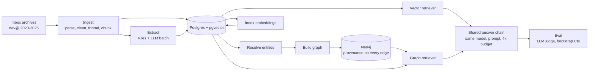

# Kafka Atlas (Design)

Arjun Chhabra

## Overview

Kafka Atlas is an engineering knowledge assistant that answers questions about a software team's history, built to test one claim: that a knowledge graph retrieves better than plain vector search when an answer spans several documents.

The corpus is three years (2023–2025) of the Apache Kafka developer mailing list plus its Jira activity. It is a public stand-in for the Slack, email and ticket history companies index internally. Typical questions: "Who proposed the KIP that the 3.7 release manager called a blocker?" or "Was this bug fixed before that proposal's vote passed?"

Two systems answer the same questions with the same model, prompt and context budget. Only retrieval differs:

- **Vector RAG baseline:** LangChain + pgvector, nearest-neighbour search over email chunks.
- **Graph RAG:** an LLM-extracted knowledge graph in Neo4j, queried through entity resolution and multi-hop graph traversal.

**Stack:** Python, Claude (Sonnet 5.5 / Opus 5.5), Voyage embeddings, Postgres + pgvector, Neo4j, LangChain, FastAPI, Docker, GCP Cloud Run + Cloud SQL, Langfuse, GitHub Actions.

## Data

The ingested corpus holds 11,847 human-written emails and 9,380 Jira events, within 1% of what the public archive statistics predicted.

| Measure | Count |
| --- | --- |
| Months ingested | 36 (Jan 2023 – Dec 2025) |
| Human-written emails | 11,847 |
| Automated mail (Jira + build bots) | 13,435 |
| Structured Jira events (created / resolved / reopened) | 9,380 |
| Retrievable documents (email chunks ≤ 500 tokens + Jira events) | 22,138 |
| Malformed emails skipped | 1 |

- **Cleaning:** quoted replies, signatures, stack traces, patches and log dumps are stripped or collapsed to short placeholders, so each email carries only what its author wrote.
- **Jira events** are parsed with rules, not an LLM, and become exact graph edges (who filed, resolved or fixed a ticket, and in which release).
- **Fairness rule:** every Jira event is also written as a one-line text document in the vector index, so both systems see the same information and only its organisation differs.

## Architecture

Both systems read the same Postgres corpus and share one answer chain; the graph path adds extraction, entity resolution and a Neo4j graph.

## Entity resolution

The same person appears as "Andrew Schofield", "Andrew", "Schofield, Andrew" or an email address. The resolver merges these mentions deterministically, without LLM calls: strong identities first (shared address, same normalised full name, abbreviated headers matched to the one full name that fits), then first-name-only mentions resolved from the email they appear in. Sign-offs mean the sender; greetings never do. Anything still ambiguous stays unresolved, because a missed link costs recall while a wrong merge corrupts the graph.

Scored with B³ on 188 hand-labelled mentions of 22 entities:

| Resolver | Precision | Recall | F1 |
| --- | --- | --- | --- |
| Exact match (baseline) | 0.991 | 0.603 | 0.750 |
| Kafka Atlas resolver | 1.000 | 0.933 | 0.965 |

The resulting graph has 24,376 nodes and 54,127 relationships. Every edge carries the IDs of the chunks that justify it, so graph retrieval returns evidence, never graph summaries.

## Graph retrieval

1. **Link:** KIP, ticket and release IDs and names in the question become weighted seeds.
2. **Walk:** up to two hops from each seed, one batched Cypher query per hop, with edge caps enforced inside Cypher so hub nodes stay cheap. Fact edges (proposed, voted, resolved) outweigh plumbing (sent, replied to), and edges the question asks about get a boost.
3. **Doc bridge:** multi-hop questions often identify a KIP only through another discussion ("the KIP Jane said was blocked by…"), which puts the answer three hops from anything named. The retriever pivots on its best first-pass documents and walks from the KIPs and tickets those documents mention.
4. **Rank and pack:** chunks connecting several seeds score highest; a hybrid rerank adds embedding similarity, and evidence is packed into the same 4,000-token budget as the baseline.

A graph-only configuration switches off every use of embeddings, isolating what the graph contributes on its own.

## Evaluation set

Questions follow the MultiHop-RAG recipe. Evidence is sampled from thread and ID links using headers and regexes only, never from the graph, so the set favours neither system. An LLM drafts each question; deterministic checks reject compound asks, date-heavy questions and giveaways (a question that reuses the linked ticket's own title), and LLM checks confirm every gold document is needed. Every surviving question was then LLM-reviewed against its source emails, and a random sample was human-verified (50 of 50 decisions confirmed).

| Type | What it tests | Questions |
| --- | --- | --- |
| Single-hop | One fact from one document | 121 |
| Inference | One email identifies a KIP or ticket; another states the answer | 166 |
| Comparison | Two related KIPs or tickets compared on substance | 48 |
| Temporal | How a proposal changed after review | 6 |
| Null | Unanswerable from the list; the system should decline | 38 |

76 questions form a tuning split and 303 a held-out test split. Each system runs on the test split once; answers are graded by Claude Opus 5.5 against the reviewed gold answer.

## Results

Held-out test split, 303 questions, both systems paired on the same questions. Cells are means with 95% bootstrap confidence intervals.

| Multi-hop (176 questions) | Vector | Graph | Graph − vector |
| --- | --- | --- | --- |
| Full-evidence rate | 0.34 | 0.45 | **+0.11 [+0.04, +0.19]** |
| Source recall | 0.56 | 0.61 | +0.05 [−0.01, +0.11] |
| Answer accuracy | 0.55 | 0.60 | +0.06 [−0.01, +0.12] |

| Other groups | Vector | Graph |
| --- | --- | --- |
| Single-hop accuracy (97) | 0.93 | 0.93 |
| Null abstention (30) | 1.00 | 1.00 |

On multi-hop questions, graph retrieval delivered every needed document 11 points more often than vector search, a statistically significant gain; answer accuracy rose 6 points. Single-hop and unanswerable questions were unchanged, at a cost of about 0.5 s more latency per question.

The largest single improvement came from diagnosing misses on the tuning split: bridge questions name only a person, and 42% of gold documents sat three hops away. Adding the doc bridge raised tuning-split multi-hop recall from 0.43 to 0.65.

## Key design decisions

The guiding rule: keep the comparison fair, and spend LLM calls only where rules can't do the job.

| Decision | Why | Trade-off |
| --- | --- | --- |
| Extract headers, IDs and Jira events by rule; use the LLM only for relations (proposed, voted, blocks, affects) | Cheaper, and gives entity resolution exact anchors to merge against | The regex layer needs care to stay precise |
| LLM outputs raw mentions, never merged entities | Keeps entity resolution a separate, testable step | More mentions to resolve |
| Batch API with persisted batch IDs, per-email cache and a cost guard | A crash never loses paid results; a re-run never pays twice; a spend estimate is shown before every run | More plumbing than a simple loop |
| Same answer model, prompt and 4,000-token context budget for both systems | Retrieval is the only variable | The graph can't win by sending more text |
| Question evidence linked by thread and ID only, never by the graph | Prevents the graph from answering questions its own graph generated | Fewer question shapes |
| Deterministic entity resolution that leaves ambiguous names unresolved | A wrong merge attaches one person's votes to another; precision stays at 1.000 | Some people stay split across nodes |
| Doc bridge: walk from the KIPs and tickets the best documents mention | Bridge questions name only a person, so the answer sits beyond a two-hop walk | A second walk per question |
| Tune only on the dev split; run the test split once | Results can't be tuned to the exam | A small dev split gives a noisy tuning signal |

**Findings from building on real data:**

- The list only receives Jira *created, resolved* and *reopened* notifications, so "assigned to" edges don't exist in this corpus.
- A naive version regex counted outline numbers ("4.6.4") and artifact names ("kafka-3.4.0.tgz" read as ticket KAFKA-3) as entities; release matching is now limited to real Kafka release lines and excludes third-party library versions.
- 82 tickets resolved as "Fixed" list no fix version anywhere, so release links are incomplete by nature.
